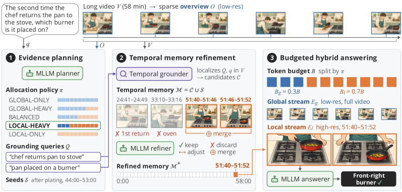

# AdaAlloc: Adaptive Visual Token Allocation for Long-Video Question Answering

Official code release for the NeurIPS 2026 paper.

**Joungbin An, Kristen Grauman** · The University of Texas at Austin ·
[Project page](https://vision.cs.utexas.edu/projects/adaalloc) ·
[arXiv](https://arxiv.org/abs/2611.09092)

AdaAlloc is a training-free agentic framework for long-video multiple-choice QA under a fixed
visual-token budget. Qwen3-VL-8B first plans, from a sparse overview of the whole video, how to split
the budget between a low-resolution global stream and high-resolution local evidence. It calls
UniversalVTG to ground the planner's queries in the video, refines the candidate moments into a compact
temporal memory, and answers from the allocated global and local streams.

<p align="center">
  
</p>

*The budget is split between low-res global context (blue) and high-res local evidence (orange).
(1) From a sparse overview, the MLLM planner picks an allocation policy and writes grounding queries.
(2) UniversalVTG localizes the queries, and the MLLM refines the candidates into a compact temporal
memory. (3) The MLLM answers from a global stream and a local stream drawn from that memory.*

## Setup

Clone with the submodules:
```bash
git clone --recursive https://github.com/jbistanbul/adaalloc.git
cd adaalloc
```
This brings [UniversalVTG](https://github.com/jbistanbul/universalvtg) to `third_party/universalvtg`
and, inside it, the Perception Encoder code
([facebookresearch/perception_models](https://github.com/facebookresearch/perception_models)) to
`third_party/universalvtg/perception_models`, both at the commits the paper runs used. In a clone made
without `--recursive`, run `git submodule update --init --recursive`.

1. **Environment.** With a CUDA 12 toolkit and `CUDA_HOME` set:
   ```bash
   conda create -n adaalloc -c conda-forge python=3.11 pip ffmpeg ninja cmake cxx-compiler
   conda activate adaalloc
   pip install torch==2.5.1 torchvision==0.20.1 torchaudio==2.5.1 --index-url https://download.pytorch.org/whl/cu124
   pip install --no-build-isolation causal-conv1d==1.6.0 mamba-ssm==2.3.0   # prebuilt wheels for torch 2.5
   bash third_party/universalvtg/install.sh   # Perception Encoder, 1D NMS and UniversalVTG's other dependencies
   pip install -r requirements.txt
   ```
   Without a CUDA toolkit, install one into the environment first:
   `conda install -c nvidia/label/cuda-12.4.1 cuda-toolkit && export CUDA_HOME=$CONDA_PREFIX`.
   The paper runs used Python 3.11, torch 2.5.1 (CUDA 12.4), transformers 4.57.6,
   qwen-vl-utils 0.0.14 and decord 0.6.0 (from conda-forge on aarch64).

2. **Weights.**
   ```bash
   huggingface-cli download Qwen/Qwen3-VL-8B-Instruct
   huggingface-cli download facebook/PE-Core-L14-336 PE-Core-L14-336.pt
   ```
   PE-Core-L14-336 encodes UniversalVTG's text queries, and the videos if you extract their features
   yourself (Data, step 3b); it is also fetched on first use. Download the UniversalVTG checkpoint
   ([UT Box](https://utexas.box.com/s/vm52tyvfqxhrnmnswm4kbe8cr1fkke6e)) so that
   `third_party/universalvtg/experiments/universalvtg/` holds `opt.yaml` and `models/best.pth`.

To use a UniversalVTG checkout elsewhere, set `ADAALLOC_UNIVERSAL_VTG_ROOT` to it. Its 1D NMS extension
must be compiled against the PyTorch that runs AdaAlloc; after changing PyTorch, rebuild it (an
extension built for another PyTorch fails to import with an `undefined symbol` error, and AdaAlloc then
tries this rebuild once by itself):
```bash
cd third_party/universalvtg/libs/nms && python setup_nms.py build_ext --inplace --force
```

## Data

Each benchmark lives under a data root as
```
<data_root>/LVBench/annotations/{video_qa.json, video_ids.json, video_paths.json, video_info.json}
<data_root>/LVBench/features/pecore/<video_id>.pt
```
(likewise `MLVU`, `Video-MME`, `LongVideoBench`; MLVU-Dev uses `MLVU/annotations_dev` and
`MLVU/features/pecore_dev`), matching `configs/datasets/*.yaml`.

1. **Download** each benchmark's official annotations and videos:

   | Benchmark | Annotations | Videos |
   |---|---|---|
   | LVBench | `video_info.meta.jsonl` from [THUDM/LVBench](https://huggingface.co/datasets/THUDM/LVBench) | from YouTube with `scripts/download.sh` of [github.com/THUDM/LVBench](https://github.com/THUDM/LVBench), as `<key>.mp4` |
   | MLVU-Test | `test-ground-truth/test_mcq_gt.json` from [MLVU/MLVU_Test](https://huggingface.co/datasets/MLVU/MLVU_Test) | `MLVU_Test/test_video.tar.gz.part-*` (same repository) |
   | MLVU-Dev | `MLVU/json/` from [MLVU/MVLU](https://huggingface.co/datasets/MLVU/MVLU) | `MLVU/video/` (same repository) |
   | Video-MME | `videomme/test-00000-of-00001.parquet` from [lmms-lab/Video-MME](https://huggingface.co/datasets/lmms-lab/Video-MME) | `videos_chunked_*.zip` (same repository) |
   | LongVideoBench | `lvb_val.json` from [longvideobench/LongVideoBench](https://huggingface.co/datasets/longvideobench/LongVideoBench) | `videos.tar.part.*` (same repository) |

   MLVU-Test and LongVideoBench ship their videos as split archives; join the parts before extracting:
   ```bash
   cat test_video.tar.gz.part-* | tar -xz      # MLVU-Test
   cat videos.tar.part.* | tar -x              # LongVideoBench
   ```

   For MLVU-Dev, the paper runs used an H.264 re-encode of the HEVC video that appears as both
   `1_plotQA/1.mp4` and `7_topic_reasoning/1.mp4` (some decord builds cannot decode it). To match
   them, replace both copies with
   ```bash
   ffmpeg -i 1.mp4 -map 0:v:0 -map 0:a? -c:v libx264 -preset veryfast -crf 18 -pix_fmt yuv420p \
       -fps_mode passthrough -c:a copy -movflags +faststart 1_h264.mp4
   ```

2. **Convert the annotations** (`--annotations` is the file above, or the `MLVU/json` directory for
   MLVU-Dev; `--videos` is the video directory, or `MLVU/video` for MLVU-Dev):
   ```bash
   python scripts/prepare_data.py lvbench --annotations video_info.meta.jsonl --videos /path/to/LVBench/videos \
       --data-root /path/to/data
   ```
   Subcommands: `lvbench`, `mlvu_test`, `mlvu_dev`, `videomme`, `longvideobench`. The script also reads
   each video's frame count and fps the way the paper runs did (OpenCV, decord for MLVU-Dev, `ffprobe`
   for LongVideoBench, which needs FFmpeg on the PATH).

3. **PE-Core features.** UniversalVTG localizes the planner's queries in PE-Core-L14-336 features of
   each video at 2 fps (`features/pecore/<video_id>.pt` in the layout above). Either download the
   features of the paper runs (a), which skips the extraction, or extract them yourself (b). The
   videos are needed either way, since the MLLM reads their frames.

   **(a) Download** the pre-extracted features from UT Box, one archive per benchmark (12 GB in all,
   checksums in [SHA256SUMS](https://utexas.box.com/s/n4o6iewzg1r1n8assw1nguu2v97rqt43)):

   | Benchmark | Archive | Size |
   |---|---|---|
   | LVBench | [adaalloc_pecore_lvbench.tar](https://utexas.box.com/s/i3suw3e7vl3dy2vpzuakz9kjfqtc1cgc) | 1.7 GB |
   | MLVU-Test | [adaalloc_pecore_mlvu_test.tar](https://utexas.box.com/s/eryeczn68vnet9v9wgvlmsxvi54l5d4a) | 1.5 GB |
   | MLVU-Dev | [adaalloc_pecore_mlvu_dev.tar](https://utexas.box.com/s/9e9mq114apt3sl3xwrvppltjr2x0oc8j) | 3.7 GB |
   | Video-MME | [adaalloc_pecore_videomme.tar](https://utexas.box.com/s/0pvq24k3t9fyanrg1apax1cevaepq4kd) | 3.8 GB |
   | LongVideoBench | [adaalloc_pecore_longvideobench.tar](https://utexas.box.com/s/tcfh2obojac72br0sfecw72huehtvg2d) | 1.5 GB |

   On a server, fetch them directly, check them and extract them into the data root:
   ```bash
   wget -O SHA256SUMS https://utexas.box.com/shared/static/n4o6iewzg1r1n8assw1nguu2v97rqt43
   wget -O adaalloc_pecore_lvbench.tar https://utexas.box.com/shared/static/i3suw3e7vl3dy2vpzuakz9kjfqtc1cgc
   wget -O adaalloc_pecore_mlvu_test.tar https://utexas.box.com/shared/static/eryeczn68vnet9v9wgvlmsxvi54l5d4a
   wget -O adaalloc_pecore_mlvu_dev.tar https://utexas.box.com/shared/static/9e9mq114apt3sl3xwrvppltjr2x0oc8j
   wget -O adaalloc_pecore_videomme.tar https://utexas.box.com/shared/static/0pvq24k3t9fyanrg1apax1cevaepq4kd
   wget -O adaalloc_pecore_longvideobench.tar https://utexas.box.com/shared/static/tcfh2obojac72br0sfecw72huehtvg2d
   sha256sum -c --ignore-missing SHA256SUMS
   for f in adaalloc_pecore_*.tar; do tar -xf "$f" -C /path/to/data; done
   ```
   The features are derived from the benchmark videos; use them under each benchmark's terms.

   **(b) Extract** them with UniversalVTG's own extractor on all visible GPUs, one benchmark at a time.
   It finds the videos through the annotation files of step 2 and skips videos that already have
   features, so an interrupted run can be restarted:
   ```bash
   scripts/extract_features.sh configs/datasets/lvbench.yaml /path/to/data   # likewise mlvu_test, mlvu_dev, videomme, longvideobench
   ```
   Features extracted on other GPUs, or from videos downloaded later (from YouTube for LVBench in
   particular), may differ slightly from the downloaded ones.

To add another benchmark, write the same four files and a config in `configs/datasets/`:
- `video_qa.json`: a JSON list (or JSON Lines) of videos,
  `{"key": video_id, "qa": [{"uid": ..., "question": "Question?\n(A) ...\n(B) ...", "answer": "B",
  "question_type": [...]}]}`.
- `video_ids.json`: the list of video ids to evaluate.
- `video_paths.json`: `{video_id: path to the video file}`.
- `video_info.json`: `{video_id: {"fps": ..., "frames": ..., "duration_sec": ...}}`; missing entries
  are probed from the video.

## Running

One GPU (resumes from `OUTPUT.jsonl` if interrupted):
```bash
python -m adaalloc.run --config configs/adaalloc_128f.yaml --dataset configs/datasets/lvbench.yaml \
    --data-root /path/to/data --output outputs/lvbench_128f.json
```
This writes the predictions (`.json`), a per-question ledger (`.json.jsonl`), the accuracy
(`.json.metrics.json`) and the resolved config (`.json.config.json`). For the 16K setting, use
`--config configs/adaalloc_64f.yaml` (see [One budget knob](#one-budget-knob-num_frames)).

Many GPUs: start any number of workers on a shared directory, then merge.
```bash
python -m adaalloc.run ... --work-dir outputs/lvbench_128f.work --rank R --world W   # each worker
python -m adaalloc.run ... --merge outputs/lvbench_128f.work                       # once all finish
```
`scripts/slurm_run.sh` does both on a Slurm cluster (rank and world come from Slurm).

Scoring (pooled accuracy; `--mavg` gives MLVU's mean over task accuracies, as reported for MLVU-Dev):
```bash
python -m adaalloc.evaluate outputs/lvbench_128f.json
python -m adaalloc.evaluate outputs/mlvu_dev_128f.json --mavg
```

## One budget knob: `num_frames`

The budget is set by one number, `budget.num_frames`: every MLLM call gets `num_frames × 256` visual
tokens, the cost of sampling that many frames at 256 tokens per frame.

| Config | `num_frames` | Visual tokens | Paper setting |
|---|---|---|---|
| `configs/adaalloc_128f.yaml` | 128 | 32,768 | 32K (main) |
| `configs/adaalloc_64f.yaml` | 64 | 16,384 | 16K |

`adaalloc_128f.yaml` holds every setting and is the base of every other budget. The 64-frame config
only changes the knob:

```yaml
base: adaalloc_128f.yaml
name: adaalloc_64f
budget:
  num_frames: 64
```

## Results of this code

Accuracy (%) with Qwen3-VL-8B-Instruct and greedy decoding:

| Budget | LVBench | MLVU-Test | VideoMME (w/o sub) | LongVideoBench-Val | MLVU-Dev (M-Avg) |
|---|---|---|---|---|---|
| 64 frames (16K) | 51.7 | 61.2 | 68.4 | 66.0 | 74.6 |
| 128 frames (32K) | 56.6 | 67.1 | 70.7 | 67.5 | 77.2 |

Results may differ slightly across GPUs and library versions.

## License

MIT (see [LICENSE](LICENSE)). Qwen3-VL, UniversalVTG and the Perception Encoder (Apache 2.0) are
separate projects under their own licenses.

## Citation

```bibtex
@inproceedings{an2026adaalloc,
  title     = {AdaAlloc: Adaptive Visual Token Allocation for Long-Video Question Answering},
  author    = {An, Joungbin and Grauman, Kristen},
  booktitle = {Advances in Neural Information Processing Systems},
  year      = {2026}
}
```
